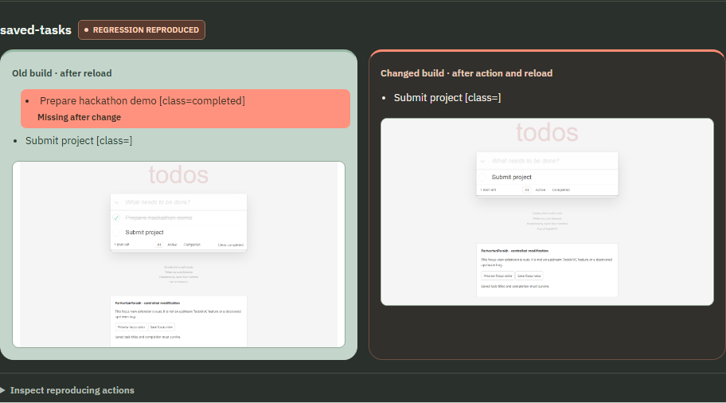
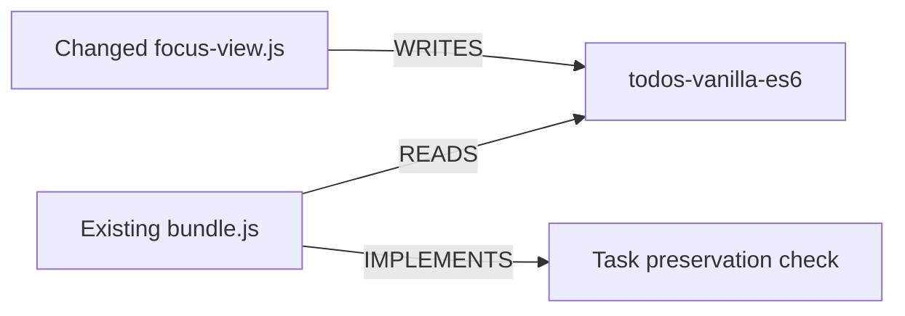

# The new feature worked. My completed task disappeared.

*Building ParivartanParakh for Graph Hacks, Track 01: Agents That Act on Connected Data.*

[Watch the working demo](https://youtu.be/a2fsXE6GVNk) · [Run the project locally](README.md#local-setup)

I kept running into a frustrating pattern with AI coding tools. I would ask for another feature. The tool would add it. Later, something I had already built would stop working.

The new screen could look fine. The problem was what it changed underneath.

For this hackathon, I chose a small example I could inspect all the way through. Two tasks. One completed. A new focus setting. And a save operation that should never have removed either task.

ParivartanParakh records what a developer wants to preserve, follows runtime dependencies in FalkorDB, and checks what actually survives the change. When a check fails, it keeps the original case so a supplied repair has to face the same expectation.

## A save button with the wrong idea

The demonstration uses a pinned TodoMVC task app with an extension I added. The bug is deliberate. I did not discover a defect in upstream TodoMVC.

The old app has two saved tasks:

| Task | State |
|---|---|
| Prepare hackathon demo | Completed |
| Submit project | Active |

The added focus feature saves only unfinished tasks into the existing task store. Its faulty operation is short enough to understand:

```javascript
localStorage.setItem(
  'todos-vanilla-es6',
  JSON.stringify(tasks.filter(task => !task.completed))
);
```

The setting says it saved successfully. After reload, the completed task is gone.

That is the distinction I wanted the demo to make visible. A button can perform its new action while breaking an older promise about saved data.



*These are captured browser observations from the controlled example, not a mockup.*

## The developer defines the promise

I did not want the agent to decide that losing a task was acceptable because the new build happened to do it.

The workflow starts in the old app. The developer creates representative data, selects the task rows, and then uses the changed feature. ParivartanParakh suggests a preservation rule using the captured text and checkbox states. The developer reviews and explicitly approves it.

Here, the expectation is simple. Both task titles and their completion states must survive saving focus view and reloading.

The approval matters. Observing an application tells us what it does. It does not tell us what it should keep doing.

## What FalkorDB decides

The browser records exercised native localStorage reads and writes. ParivartanParakh associates those operations with JavaScript modules and builds a graph for the investigation.



The dependency query follows that relationship:

```cypher
MATCH (w:Module)-[:WRITES]->(k:StorageKey)<-[:READS]-(r:Module)-[:IMPLEMENTS]->(f:Feature)
WHERE w.changed = true AND w.id <> r.id
RETURN DISTINCT w.id, k.id, r.id, f.id ORDER BY f.id
```

The result supplies eligible check targets. The graph picture is an explanation of the selection, not the source of a separate hand-written answer.

I kept the AI's job bounded. A local Ollama model chooses validated tools such as `query_dependencies` and `run_check`. The host runs reviewed Cypher and validates targets. The model does not generate arbitrary queries or decide whether the browser assertion passed.

The graph says there is a reason to check the older task behavior. Chromium establishes whether that behavior actually broke.

## Make the failure small enough to fix

The recorded changed workflow includes previewing the focus color and saving the setting. Once the browser reproduces the failure, the reducer tries removing trigger actions while preserving the failure.

In this example, the preview action is unnecessary. Saving alone is enough.

This is deletion reduction, not a guarantee of the globally shortest reproducer. It still gives a developer a more useful starting point than a long recording with unexplained clicks.

The repair brief packages the expectation, observations, reduced actions, and dependency evidence. It omits the raw localStorage snapshot. The developer should still review recorded inputs before sharing it with another tool.

## A repair should not get to rewrite the test

This became my favorite part of the project.

I prepared a compatible revision that keeps the tasks and adds a `focusVisible` property instead of filtering completed tasks out of storage. ParivartanParakh checks that supplied revision against the original failure.

It reuses the original saved data, preservation rule, and reduced actions. It does not accept the repair's own manifest as a replacement expectation.

The repaired example preserves both tasks. Supplying the broken revision again fails the retained case again.

There is another detail here. What if a repair changes the dependency that originally caused the check to run? The previous failure should not vanish from consideration just because the current impact path disappears.

Repair investigations add a retained obligation to FalkorDB:

```text
RegressionCase → REQUIRES_REPLAY → Feature
```

The backend retrieves it with a separate query:

```cypher
MATCH (c:RegressionCase)-[:REQUIRES_REPLAY]->(f:Feature)
RETURN DISTINCT f.id ORDER BY f.id
```

That obligation supplements current impact selection. Replay is explicit today. The library does not automatically watch every future edit.

## Test the missing evidence too

A convincing green result needs a failure path behind it.

The implementation includes controls for ineffective repairs, missing graph relationships, and unavailable services. The UI can remove read edges before selection. The backend checks the graph against the recorded operations and reports missing evidence rather than silently rebuilding dependency selection in Python.

An empty or incomplete investigation is not an application-wide safety result.

I also checked the recorder, explicit approval, repair replay, source-integrity guards, and regression library with automated browser and integration tests. Those checks support this implementation's bounded behavior. They do not establish productivity gains or adoption by other developers.

## What I would build next

The current boundary is narrow: trusted static JavaScript revisions, flat module attribution, native localStorage, and declared workflows. It does not support arbitrary React or Next.js applications, backend databases, IndexedDB, or automatic repair.

My next step would be a second real application and a stronger attribution method for bundled code. I would measure missed dependencies and incorrect associations before claiming broader coverage.

Graphs are not the only way to represent this small example. FalkorDB earns its place in this implementation because query results govern check selection and retained-case obligations. I have not benchmarked it against other databases.

I started with a broad frustration about AI coding. The useful result was much more specific. A developer can approve an expectation, see a dependency path, reproduce a failure, and ask a supplied repair to pass the original case.

## Code and credits

[Source, setup instructions, graph model, and queries](https://github.com/barkingbeast/ParivartanParakh)

[Six-minute working demo](https://youtu.be/a2fsXE6GVNk)

OpenAI Codex assisted with implementation, tests, documentation, UI work, and this article. I chose the problem, reviewed iterations, and recorded the demonstration. TodoMVC and bundled fonts retain their original licenses and attribution in [THIRD_PARTY.md](THIRD_PARTY.md).
